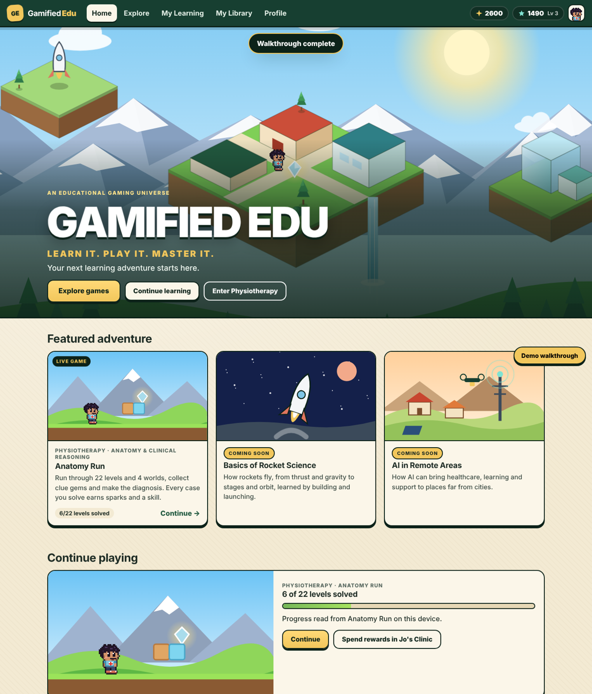

# Gamified Edu: interactive platform demo

**Learn it. Play it. Master it.** An educational gaming universe. Today it holds one live world, Physiotherapy,
with two games, **Anatomy Run** and **Root Raid: Body City**, and its reward space, **Jo's Clinic**. Two more worlds are live too: **Basics of Rocket Science** (Liftoff Lab)
and **AI in Remote Areas** (Village Lab).

- Live demo: https://josesyson-physio.github.io/GamEdu/
- Live game: [Anatomy Run](https://josesyson-physio.github.io/anatomy_run/) (unchanged, opened top-level, never embedded)
- New game: [Root Raid: Body City](https://josesyson-physio.github.io/GamEdu/root-cause/) (in `root-cause/`)
- Rocket Science: [Liftoff Lab](https://josesyson-physio.github.io/GamEdu/rocket/) (in `rocket/`)
- AI in Remote Areas: [Village Lab](https://josesyson-physio.github.io/GamEdu/village/) (in `village/`)

## The concept
1. **Play** Anatomy Run. Every level solved earns sparks (more for more stars) and one case skill. Each of the 4 worlds completed pays a bonus.
2. **Skills set the limit.** Completing a world unlocks its clinic buildings. Every case in that world at 2★ allows level 2; 3★ (mastery) allows level 3.
3. **Build** in Jo's Clinic (inside Physiotherapy). Sparks pay; skills decide how far each building can grow.
4. **Play Root Raid: Body City.** An open-world city built inside the body. Roam the streets, meet people who need help, run tests at street kiosks, send the red flag to hospital, find the right hideout and raid the root cause. No quiz screens. Each case pays sparks and a treatment skill.
5. **Goal:** complete all four worlds, build every building, then build the **Futuristic Smart Clinic**.

## Screens
| Screen | What works |
|---|---|
| Home | Isometric hero world, featured, continue playing (real Anatomy Run progress), categories, journey |
| Explore | Physiotherapy, Basics of Rocket Science and AI in Remote Areas, all live |
| Rocket Science | Liftoff Lab: 5 flight-school missions (including the Flight Puzzle) plus Mission Control (Thrust Tuner, Countdown Crew, Orbit Desk), progress per mission |
| AI in Remote Areas | Village Lab: 6 village projects plus the Data Detective AI lab (3 labs) and a shareable project card, best score per unit |
| Physiotherapy | Anatomy Run, the reward loop, Jo's Clinic, skill map, Smart Clinic goal |
| Anatomy Run page | Launches the real game in its own tab; rewards explained; real progress shown |
| Root Cause page | Launches Body City; rewards, treatment skills and how a case works |
| Skill map | 22 case skills in 4 worlds, with stars and what each world unlocks |
| Jo's Clinic | 12 isometric buildings; skill-capped upgrades with 3 visible levels each |
| Smart Clinic | Revealed world by world; full vision preview, clearly labelled |
| Profile | Jo, level, XP, sparks, skills, badges, ledger, reset |

## Security
Static site, no backend, no accounts, no payments, no tracking. Strict CSP (scripts from this site only, no network calls),
anti-framing guard, read-only access to Anatomy Run's save. `node scripts/security-check.mjs` runs 64 checks (including every game folder); CI blocks deploys that fail.

## Licence
Copyright (c) 2026 MotionPlus Physio Pvt. Ltd. All rights reserved. See `LICENSE`.

Exception: the clinical content in `root-cause/cases.js` is adapted from the Learn Anywhere library
(Learn Anywhere contributors, CC BY-NC-SA 4.0). That file stays under CC BY-NC-SA 4.0: non-commercial use, with credit, shared alike.
It is a draft pending review by the clinical panel.
